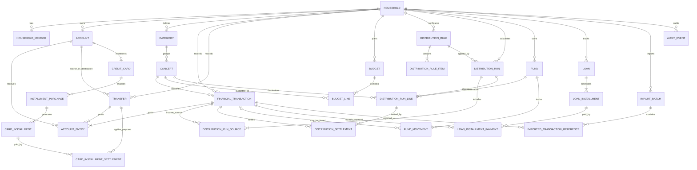

# HomeFinance — Domain Model v1.0

**Estado:** Propuesta técnica inicial  
**Versión:** 1.0  
**Fecha:** 6 de noviembre de 2026  
**Tecnologías objetivo:** .NET 10 / ASP.NET Core, EF Core, PostgreSQL, Angular  
**Alcance:** modelo de dominio, persistencia, reglas financieras, casos de uso y decisiones arquitectónicas.

> Este documento transforma el modelo actual de Excel en un modelo de aplicación. No replica las hojas: conserva sus reglas financieras y separa operaciones reales, planificación, fondos y compromisos futuros.

---

## 1. Objetivo y principios

HomeFinance debe permitir registrar y analizar la economía de un hogar de forma simple, trazable y extensible. La información financiera registrada en la aplicación será la fuente de verdad; los paneles, porcentajes y proyecciones serán resultados calculados.

### 1.1 Principios del dominio

1. **Una sola fuente de verdad:** los movimientos financieros confirmados son la fuente de los ingresos, egresos y saldos de cuentas.
2. **Planificación separada de ejecución:** un presupuesto o una asignación no es una transacción real.
3. **Sin doble contabilización:** transferir dinero, reservarlo en un fondo o pagar el resumen de una tarjeta no debe crear un segundo gasto.
4. **Trazabilidad:** cada importe debe poder responder qué representa, a qué fecha/período pertenece, de dónde proviene y con qué operación se relaciona.
5. **Historial preservado:** una operación confirmada no se elimina físicamente. Se anula con trazabilidad.
6. **Configurabilidad:** categorías, conceptos y porcentajes no deben estar codificados en el backend.
7. **Cálculo reproducible:** los indicadores se calculan a partir de datos y reglas identificables; no se guardan como textos formateados.
8. **Aislamiento por hogar:** cada registro financiero pertenece a un hogar y no puede relacionarse con datos de otro hogar.
9. **Fechas financieras explícitas:** la fecha del hecho económico determina el período; la fecha de creación sirve para auditoría.
10. **Precisión monetaria:** los cálculos usan `decimal` en .NET y `numeric` en PostgreSQL; nunca `float` o `double`.

### 1.2 Fuera de alcance de esta versión

- Conexión directa con bancos, tarjetas o billeteras.
- Conciliación automática con extractos externos.
- Conversión y compensación de transferencias entre monedas distintas.
- Contabilidad patrimonial completa de préstamos (capital, intereses, amortización y pasivos).
- Sincronización offline multi-dispositivo.
- Microservicios y procesamiento distribuido.

---

## 2. Decisiones funcionales clave

Estas decisiones fijan cómo se interpretará la información del Excel en la aplicación.

### 2.1 Ingreso y distribución 85/10/5

Para el ejemplo actual, el ingreso base es la suma de las transacciones confirmadas con concepto **Sueldos** dentro del mes seleccionado. Una regla vigente distribuye ese importe:

| Destino | Porcentaje | Tratamiento |
|---|---:|---|
| Presupuesto general | 85% | Capacidad disponible para crear líneas de presupuesto |
| Diezmo | 10% | Importe reservado; no es egreso hasta que se registre el pago |
| Ahorros | 5% | Aporte a un fondo virtual; no es egreso ni transferencia bancaria por sí mismo |

Con un ingreso base de **$3.175.000**:

- Presupuesto general: **$2.698.750**.
- Diezmo reservado: **$317.500**.
- Ahorros asignados: **$158.750**.

Los porcentajes se configuran en reglas con fecha de vigencia. Cada ejecución de la regla conserva una fotografía de los porcentajes y montos usados para que un cambio futuro no modifique períodos anteriores. Una ejecución confirmada es inmutable; una corrección genera una nueva versión y revierte, con trazabilidad, los efectos derivados de la versión anterior antes de aplicar los nuevos.

**Diezmo:** reservar el 10% no genera una transacción. Cuando se realiza el pago, se registra un egreso real con el concepto Diezmo y se lo vincula con la asignación reservada, total o parcialmente.

**Ahorros:** asignar el 5% a un fondo incrementa el saldo del fondo virtual. No reduce el saldo bancario ni genera un egreso. Si además se mueve físicamente el dinero a otra cuenta, se registra una transferencia independiente.

### 2.2 Presupuesto, ejecutado y disponible

Para un concepto y período:

`Ejecutado = Egresos confirmados - Reintegros confirmados`

`Disponible = Presupuestado - Ejecutado`

La interfaz debe mostrar las tres medidas. La antigua columna `real` del Excel se interpreta como **Disponible**, no como ejecutado.

### 2.3 Importe sin asignar

`ImporteSinAsignar = PresupuestoGeneralDistribuido - SUM(PresupuestosDeConceptos)`

No es saldo bancario, efectivo disponible ni patrimonio. Puede ser negativo si se presupuestó más que el fondo general distribuido; en ese caso se muestra el déficit y una advertencia, sin ocultarlo ni limitarlo artificialmente a cero.

### 2.4 Fondos personales

Un fondo es un **sobre virtual de asignación**, no necesariamente una cuenta bancaria. El saldo del fondo se calcula con sus movimientos:

`SaldoFondo = SaldoInicial + Aportes - Retiros + Ajustes`

El dinero continúa perteneciendo a una cuenta financiera. Una contribución a un fondo no es un gasto. Un retiro reduce el saldo del fondo; si se utiliza para una compra, el egreso real se registra en Finanzas y se vincula al retiro. El reporte de gastos cuenta la transacción una sola vez.

### 2.5 Tarjetas: compra frente a compromiso

Se distinguen dos hechos:

- **Compra:** gasto real por el importe total, registrado una sola vez en la fecha de compra y asociado a la cuenta de pasivo de la tarjeta.
- **Cuotas:** cronograma de compromisos de pago futuros; no son nuevos gastos.
- **Pago del resumen:** transferencia desde una cuenta de activo hacia la cuenta de pasivo de la tarjeta. Reduce la deuda, pero no vuelve a contabilizar el gasto.

Por lo tanto, el dashboard ofrecerá medidas separadas de **gastos ejecutados** y **compromisos de cuotas**. Esta política evita duplicar el gasto. Si más adelante se necesita un presupuesto basado en vencimientos, se agregará una vista de flujo de caja por cuota, sin alterar la fecha ni el importe del gasto original.

### 2.6 Créditos personales

En v1, el crédito se modela como un compromiso de flujo de caja: tiene cronograma, vencimientos y pagos vinculados a egresos reales. El importe completo de la cuota pagada se clasifica según el concepto Crédito, reproduciendo el control presupuestario actual. La separación contable entre capital e intereses queda para una versión patrimonial posterior.

### 2.7 Períodos y fechas

- El período mensual se representa con `period_start`, siempre el primer día del mes (`DATE`).
- Para noviembre de 2026: desde `2026-11-01` inclusive hasta `2026-12-01` exclusivo.
- Las fechas financieras se guardan como `DATE` en el calendario local del hogar.
- Las marcas de auditoría se guardan como `TIMESTAMPTZ` en UTC.
- El hogar tiene una zona horaria; valor inicial sugerido: `America/Argentina/Cordoba`.

---

## 3. Módulos de dominio

| Módulo | Responsabilidad | Entidades principales |
|---|---|---|
| Administración | Hogar, miembros, parámetros, auditoría | Household, HouseholdMember, AuditEvent |
| Catálogos | Clasificación de ingresos y gastos | Category, Concept |
| Finanzas | Cuentas, movimientos, transferencias y saldos | Account, FinancialTransaction, AccountEntry, Transfer |
| Planificación | Reglas de distribución y presupuesto mensual | DistributionRule, DistributionRun, Budget, BudgetLine |
| Fondos | Dinero reservado por objetivo | Fund, FundMovement |
| Tarjetas | Compras financiadas y cronograma | CreditCard, InstallmentPurchase, CardInstallment |
| Créditos | Préstamos y cronograma de pagos | Loan, LoanInstallment |
| Importación | Migración y carga de movimientos externos | ImportBatch, ImportedTransactionReference |
| Análisis | Indicadores y proyecciones calculadas | Vistas/consultas; no requiere tablas de resumen inicialmente |

---

## 4. Diagrama entidad-relación

El diagrama muestra las relaciones principales. Los campos `household_id` se repiten en las tablas de negocio para aplicar aislamiento y claves foráneas compuestas.



> Nota: Mermaid no expresa todas las restricciones condicionales. Por ejemplo, una línea de distribución puede apuntar a un fondo **o** a un concepto, según su tipo; y cada transferencia debe generar exactamente dos apuntes de cuenta.

---

## 5. Diccionario de datos

### 5.1 Convenciones

- PK: clave primaria UUID.
- FK: clave foránea.
- `numeric(19,4)`: importe con precisión decimal; la presentación respeta los decimales de la moneda.
- `char(3)`: código de moneda ISO 4217, por ejemplo `ARS`.
- `date`: fecha financiera sin hora.
- `timestamptz`: instante de auditoría en UTC.
- Nulos: se indican como `NULL` cuando son permitidos.
- Los campos `id`, `household_id`, `created_at` y `updated_at` se omiten de algunas filas por repetición, pero se consideran en todas las entidades de negocio según corresponda.

### 5.2 Administración y catálogos

| Tabla | Campo | Tipo | Restricción / uso |
|---|---|---|---|
| `households` | `id` | UUID | PK |
| | `name` | varchar(120) | Obligatorio |
| | `base_currency_code` | char(3) | Default `ARS` |
| | `time_zone` | varchar(80) | Default `America/Argentina/Cordoba` |
| | `created_at` | timestamptz | Obligatorio |
| `household_members` | `id` | UUID | PK |
| | `household_id` | UUID | FK → households |
| | `identity_user_id` | varchar(450) | FK lógica a ASP.NET Identity; no almacenar credenciales propias |
| | `role` | varchar/enum | `Owner`, `Member`, `Viewer` |
| | `status` | varchar/enum | `Active`, `Invited`, `Disabled` |
| | `joined_at` | timestamptz | NULL hasta aceptar invitación |
| `categories` | `id` | UUID | PK |
| | `household_id` | UUID | FK → households |
| | `name` | varchar(80) | Obligatorio; único por hogar y tipo |
| | `kind` | enum | `Income`, `Expense`, `Both` |
| | `sort_order` | int | Orden visual |
| | `is_active` | boolean | Default true; desactivar en vez de borrar |
| `concepts` | `id` | UUID | PK |
| | `household_id` | UUID | FK → households |
| | `category_id` | UUID | FK compuesta → categories |
| | `code` | varchar(40) | Código estable opcional; único por hogar si se informa |
| | `name` | varchar(100) | Obligatorio; texto visible, no es clave |
| | `kind` | enum | `Income`, `Expense`, `Both` |
| | `is_budgetable` | boolean | Indica si puede recibir una línea de presupuesto |
| | `is_active` | boolean | Default true |

### 5.3 Finanzas y cuentas

| Tabla | Campo | Tipo | Restricción / uso |
|---|---|---|---|
| `accounts` | `id` | UUID | PK |
| | `household_id` | UUID | FK → households |
| | `name` | varchar(100) | Nombre visible |
| | `account_type` | enum | `Cash`, `Bank`, `DigitalWallet`, `Savings`, `CreditCard`, `Other` |
| | `nature` | enum | `Asset` o `Liability` |
| | `currency_code` | char(3) | Obligatorio |
| | `opening_balance` | numeric(19,4) | Saldo inicial a la fecha de apertura |
| | `opening_balance_date` | date | Fecha desde la que se computan los apuntes |
| | `is_active` | boolean | Default true |
| `financial_transactions` | `id` | UUID | PK |
| | `household_id` | UUID | FK → households |
| | `concept_id` | UUID | FK compuesta → concepts |
| | `type` | enum | `Income`, `Expense`, `ExpenseRefund` |
| | `amount` | numeric(19,4) | Mayor que cero; importe total del hecho |
| | `currency_code` | char(3) | Debe coincidir con las cuentas afectadas en v1 |
| | `transaction_date` | date | Fecha efectiva del hecho económico |
| | `description` | varchar(500) | NULL permitido |
| | `status` | enum | `Draft`, `Posted`, `Voided` |
| | `created_by_user_id` | varchar(450) | Usuario Identity |
| | `posted_at` | timestamptz | NULL hasta confirmar |
| | `voided_at` | timestamptz | NULL salvo anulación |
| `account_entries` | `id` | UUID | PK |
| | `household_id` | UUID | FK → households |
| | `account_id` | UUID | FK compuesta → accounts |
| | `financial_transaction_id` | UUID | FK compuesta → financial_transactions; exactamente uno entre este campo y `transfer_id` |
| | `transfer_id` | UUID | FK compuesta → transfers; exactamente uno entre este campo y `financial_transaction_id` |
| | `entry_date` | date | Fecha del evento; copiada para indexar consultas |
| | `signed_amount` | numeric(19,4) | Distinto de cero; delta del saldo normalizado de la cuenta |
| `transfers` | `id` | UUID | PK |
| | `household_id` | UUID | FK → households |
| | `source_account_id` | UUID | FK compuesta → accounts; cuenta de origen, debe ser Asset en v1 |
| | `destination_account_id` | UUID | FK compuesta → accounts; destino Asset o Liability |
| | `amount` | numeric(19,4) | Mayor que cero |
| | `currency_code` | char(3) | Debe coincidir en ambas cuentas en v1 |
| | `transfer_date` | date | Fecha efectiva |
| | `status` | enum | `Draft`, `Posted`, `Voided` |
| | `description` | varchar(500) | NULL permitido |

**Convención de `account_entries.signed_amount`:** un valor positivo aumenta el saldo mostrado de la cuenta; uno negativo lo reduce. En cuentas de activo, el saldo representa dinero disponible. En cuentas de pasivo, representa deuda pendiente. Ejemplos:

- Ingreso de $100.000 a banco: apunte `+100.000` en una cuenta Asset.
- Gasto de $20.000 desde banco: apunte `-20.000` en una cuenta Asset.
- Compra de $30.000 con tarjeta: apunte `+30.000` en una cuenta Liability.
- Pago de $30.000 de banco a tarjeta: `-30.000` en banco y `-30.000` en la tarjeta.
- Transferencia entre dos cuentas Asset: `-X` en origen y `+X` en destino.

El saldo de una cuenta es `opening_balance + SUM(account_entries.signed_amount)` considerando únicamente apuntes asociados a eventos `Posted`. El patrimonio financiero neto simplificado es `SUM(saldos Asset) - SUM(saldos Liability)`.

Una transacción puede tener uno o varios apuntes para permitir pagos combinados en futuras versiones. En v1, los casos habituales tendrán un apunte por transacción. Una transferencia confirmada debe producir exactamente dos apuntes dentro de la misma transacción de base de datos.

### 5.4 Presupuesto y distribución

| Tabla | Campo | Tipo | Restricción / uso |
|---|---|---|---|
| `budgets` | `id` | UUID | PK |
| | `household_id` | UUID | FK → households |
| | `period_start` | date | Siempre primer día del mes |
| | `status` | enum | `Draft`, `Active`, `Closed` |
| | `distribution_run_id` | UUID | FK nullable → distribución confirmada que aporta el fondo general |
| | `notes` | varchar(500) | NULL permitido |
| `budget_lines` | `id` | UUID | PK |
| | `household_id` | UUID | FK → households |
| | `budget_id` | UUID | FK compuesta → budgets |
| | `concept_id` | UUID | FK compuesta → concepts; debe ser presupuestable y de tipo Expense |
| | `planned_amount` | numeric(19,4) | Mayor o igual a cero |
| `distribution_rules` | `id` | UUID | PK |
| | `household_id` | UUID | FK → households |
| | `name` | varchar(100) | Ej. Distribución de sueldo |
| | `source_concept_id` | UUID | FK compuesta → concepts; ej. Sueldos |
| | `effective_from` | date | Inclusiva |
| | `effective_to` | date | NULL o exclusiva según convención definida; v1 recomienda inclusiva y validar no solapamientos |
| | `is_active` | boolean | Habilitada para nuevos períodos |
| `distribution_rule_items` | `id` | UUID | PK |
| | `household_id` | UUID | FK → households |
| | `distribution_rule_id` | UUID | FK compuesta → distribution_rules |
| | `destination_type` | enum | `GeneralBudget`, `Fund`, `PlannedExpense` |
| | `fund_id` | UUID | FK nullable → funds; requerido si destino Fund |
| | `concept_id` | UUID | FK nullable → concepts; requerido si destino PlannedExpense |
| | `percentage` | numeric(7,4) | Entre 0 y 100 |
| | `sort_order` | int | Orden determinista para redondeos |
| `distribution_runs` | `id` | UUID | PK |
| | `household_id` | UUID | FK → households |
| | `distribution_rule_id` | UUID | FK → distribution_rules |
| | `period_start` | date | Primer día del mes |
| | `version` | int | Comienza en 1; aumenta ante recálculo explícito |
| | `source_amount` | numeric(19,4) | Ingreso base calculado |
| | `status` | enum | `Draft`, `Confirmed`, `Superseded`, `Cancelled` |
| | `calculated_at` | timestamptz | Momento del cálculo |
| | `confirmed_at` | timestamptz | NULL hasta confirmar |
| `distribution_run_sources` | `id` | UUID | PK |
| | `household_id` | UUID | FK → households |
| | `distribution_run_id` | UUID | FK compuesta → distribution_runs |
| | `financial_transaction_id` | UUID | FK compuesta → financial_transactions; solo Income Posted |
| | `included_amount` | numeric(19,4) | Importe incluido del ingreso |
| `distribution_run_lines` | `id` | UUID | PK |
| | `household_id` | UUID | FK → households |
| | `distribution_run_id` | UUID | FK compuesta → distribution_runs |
| | `destination_type` | enum | `GeneralBudget`, `Fund`, `PlannedExpense` |
| | `fund_id` | UUID | FK nullable → funds |
| | `concept_id` | UUID | FK nullable → concepts |
| | `percentage_snapshot` | numeric(7,4) | Porcentaje utilizado al calcular |
| | `amount_snapshot` | numeric(19,4) | Importe asignado y redondeado |
| | `destination_name_snapshot` | varchar(100) | Etiqueta histórica para lectura; no reemplaza la FK |
| `distribution_settlements` | `id` | UUID | PK |
| | `household_id` | UUID | FK → households |
| | `distribution_run_line_id` | UUID | FK compuesta → distribution_run_lines |
| | `financial_transaction_id` | UUID | FK compuesta → financial_transactions; egreso real que paga una reserva |
| | `settled_amount` | numeric(19,4) | Mayor que cero; permite pagos parciales |

Reglas condicionales para `distribution_rule_items` y `distribution_run_lines`:

- `GeneralBudget`: `fund_id` y `concept_id` deben ser NULL.
- `Fund`: `fund_id` obligatorio y `concept_id` NULL.
- `PlannedExpense`: `concept_id` obligatorio y `fund_id` NULL.
- La suma de porcentajes de una regla debe ser exactamente 100% antes de activarla (validación transaccional de aplicación; un `CHECK` simple no puede validar sumas entre filas).

### 5.5 Fondos

| Tabla | Campo | Tipo | Restricción / uso |
|---|---|---|---|
| `funds` | `id` | UUID | PK |
| | `household_id` | UUID | FK → households |
| | `name` | varchar(100) | Ej. Ahorros, Arreglos, Vacaciones |
| | `objective_amount` | numeric(19,4) | NULL o mayor que cero |
| | `initial_balance` | numeric(19,4) | Default 0 |
| | `target_date` | date | NULL permitido |
| | `status` | enum | `Active`, `Completed`, `Archived` |
| `fund_movements` | `id` | UUID | PK |
| | `household_id` | UUID | FK → households |
| | `fund_id` | UUID | FK compuesta → funds |
| | `type` | enum | `Contribution`, `Withdrawal`, `Adjustment` |
| | `amount` | numeric(19,4) | Mayor que cero; el tipo determina el signo |
| | `movement_date` | date | Fecha efectiva |
| | `financial_transaction_id` | UUID | FK nullable → financial_transactions; vincula el gasto real si corresponde |
| | `distribution_run_line_id` | UUID | FK nullable → distribution_run_lines; evita duplicar aportes de una asignación |
| | `description` | varchar(300) | Motivo o referencia |

### 5.6 Tarjetas y cuotas

| Tabla | Campo | Tipo | Restricción / uso |
|---|---|---|---|
| `credit_cards` | `id` | UUID | PK |
| | `household_id` | UUID | FK → households |
| | `account_id` | UUID | FK → accounts; cuenta de naturaleza Liability y tipo CreditCard; única |
| | `name` | varchar(100) | Nombre visible |
| | `closing_day` | smallint | 1–31; NULL si no se configura |
| | `due_day` | smallint | 1–31; NULL si no se configura |
| | `is_active` | boolean | Default true |
| `installment_purchases` | `id` | UUID | PK |
| | `household_id` | UUID | FK → households |
| | `credit_card_id` | UUID | FK compuesta → credit_cards |
| | `financial_transaction_id` | UUID | FK compuesta → financial_transactions; compra Expense asociada |
| | `concept_id` | UUID | FK compuesta → concepts |
| | `description` | varchar(300) | Detalle de compra |
| | `purchase_date` | date | Fecha de compra |
| | `first_due_date` | date | Vencimiento de la primera cuota |
| | `total_amount` | numeric(19,4) | Importe total financiado |
| | `installments_count` | smallint | Mayor que cero |
| `card_installments` | `id` | UUID | PK |
| | `household_id` | UUID | FK → households |
| | `installment_purchase_id` | UUID | FK compuesta → installment_purchases |
| | `installment_number` | smallint | 1..N; único por compra |
| | `due_date` | date | Vencimiento de la cuota |
| | `amount` | numeric(19,4) | Mayor que cero |
| | `status` | enum | `Pending`, `PartiallyPaid`, `Paid`, `Cancelled`; `Overdue` se deriva por fecha y saldo pendiente |
| `card_installment_settlements` | `id` | UUID | PK |
| | `household_id` | UUID | FK → households |
| | `card_installment_id` | UUID | FK compuesta → card_installments |
| | `transfer_id` | UUID | FK compuesta → transfers; pago del resumen |
| | `amount_applied` | numeric(19,4) | Mayor que cero; admite pagos parciales y un pago aplicado a varias cuotas |

La compra se registra como `Expense` por el total y produce un apunte positivo en la cuenta Liability de la tarjeta. Las cuotas proyectan vencimientos. Al pagar el resumen se crea una transferencia desde una cuenta Asset hacia la cuenta Liability de la tarjeta y se distribuye ese pago entre las cuotas mediante `card_installment_settlements`.

### 5.7 Créditos

| Tabla | Campo | Tipo | Restricción / uso |
|---|---|---|---|
| `loans` | `id` | UUID | PK |
| | `household_id` | UUID | FK → households |
| | `entity_name` | varchar(120) | Entidad o acreedor |
| | `description` | varchar(300) | NULL permitido |
| | `original_amount` | numeric(19,4) | Mayor que cero |
| | `start_date` | date | Inicio |
| | `installments_count` | smallint | Mayor que cero |
| | `status` | enum | `Active`, `Completed`, `Cancelled` |
| `loan_installments` | `id` | UUID | PK |
| | `household_id` | UUID | FK → households |
| | `loan_id` | UUID | FK compuesta → loans |
| | `installment_number` | smallint | 1..N; único por crédito |
| | `due_date` | date | Vencimiento |
| | `amount` | numeric(19,4) | Importe total de cuota |
| | `status` | enum | `Pending`, `PartiallyPaid`, `Paid`, `Cancelled`; `Overdue` se deriva |
| `loan_installment_payments` | `id` | UUID | PK |
| | `household_id` | UUID | FK → households |
| | `loan_installment_id` | UUID | FK compuesta → loan_installments |
| | `financial_transaction_id` | UUID | FK compuesta → financial_transactions; debe ser Expense |
| | `amount_applied` | numeric(19,4) | Mayor que cero; permite pago parcial |

En v1, cada pago de cuota es un egreso real clasificado por el concepto correspondiente. La distinción entre amortización de capital e intereses queda explícitamente fuera del alcance.

### 5.8 Importación y auditoría

| Tabla | Campo | Tipo | Restricción / uso |
|---|---|---|---|
| `import_batches` | `id` | UUID | PK |
| | `household_id` | UUID | FK → households |
| | `source` | varchar(40) | Ej. `Excel`, `MercadoPago`, `BankCSV` |
| | `file_name` | varchar(255) | Nombre de archivo, NULL permitido |
| | `status` | enum | `Pending`, `Processed`, `PartiallyProcessed`, `Failed` |
| | `imported_at` | timestamptz | Momento de importación |
| | `created_by_user_id` | varchar(450) | Usuario que ejecutó la importación |
| `imported_transaction_references` | `id` | UUID | PK |
| | `household_id` | UUID | FK → households |
| | `import_batch_id` | UUID | FK compuesta → import_batches |
| | `financial_transaction_id` | UUID | FK compuesta → financial_transactions |
| | `source_system` | varchar(60) | Identifica el origen |
| | `external_id` | varchar(160) | Identificador estable del movimiento externo |
| `audit_events` | `id` | UUID | PK |
| | `household_id` | UUID | FK → households |
| | `actor_user_id` | varchar(450) | Usuario responsable |
| | `entity_type` | varchar(80) | Nombre lógico de entidad |
| | `entity_id` | UUID | Identificador del registro afectado |
| | `action` | enum | `Create`, `Update`, `Post`, `Void`, `Import`, `Reconcile` |
| | `before_data` | jsonb | Estado anterior, NULL para alta |
| | `after_data` | jsonb | Estado posterior, NULL cuando corresponda |
| | `occurred_at` | timestamptz | UTC |

---

## 6. Cardinalidades, claves y restricciones

| Relación | Cardinalidad | Regla |
|---|---|---|
| Household → HouseholdMember | 1:N | Un usuario puede participar de más de un hogar, con una membresía por hogar |
| Household → Account | 1:N | Una cuenta pertenece a un único hogar |
| Household → Category | 1:N | Catálogo independiente por hogar |
| Category → Concept | 1:N | Un concepto pertenece a una categoría |
| Concept → FinancialTransaction | 1:N | Una transacción tiene exactamente un concepto |
| FinancialTransaction → AccountEntry | 1:N | Una operación confirmada tiene al menos un apunte; admite pago dividido |
| Account → AccountEntry | 1:N | Los saldos se derivan de los apuntes |
| Transfer → AccountEntry | 1:2 | Exactamente dos apuntes: origen y destino |
| Budget → BudgetLine | 1:N | Un presupuesto mensual contiene líneas |
| Concept → BudgetLine | 1:N | Una línea presupuestaria corresponde a un concepto |
| DistributionRule → DistributionRuleItem | 1:N | La suma de porcentajes debe ser 100% |
| DistributionRun → DistributionRunSource | 1:N | Conserva los ingresos usados en el cálculo |
| DistributionRun → DistributionRunLine | 1:N | Conserva el detalle de destinos y montos |
| Fund → FundMovement | 1:N | El saldo surge de su libro de movimientos |
| CreditCard → InstallmentPurchase | 1:N | Una tarjeta puede financiar varias compras |
| InstallmentPurchase → CardInstallment | 1:N | Una compra genera N cuotas |
| CardInstallment ↔ Transfer | N:M | Una transferencia puede pagar varias cuotas; una cuota puede pagarse parcialmente |
| Loan → LoanInstallment | 1:N | Un crédito tiene su cronograma |
| LoanInstallment ↔ FinancialTransaction | N:M | Permite pagos parciales y un pago aplicado a más de una cuota |

### 6.1 Claves únicas recomendadas

- `household_members`: UNIQUE (`household_id`, `identity_user_id`).
- `categories`: UNIQUE (`household_id`, `kind`, `normalized_name`).
- `concepts`: UNIQUE (`household_id`, `normalized_name`); UNIQUE (`household_id`, `code`) cuando `code` no sea NULL.
- `budgets`: UNIQUE (`household_id`, `period_start`).
- `budget_lines`: UNIQUE (`budget_id`, `concept_id`).
- `account_entries`: UNIQUE (`financial_transaction_id`, `account_id`) cuando `financial_transaction_id` no es NULL; UNIQUE (`transfer_id`, `account_id`) cuando `transfer_id` no es NULL. Implementar como índices únicos parciales en PostgreSQL.
- `distribution_run_sources`: UNIQUE (`distribution_run_id`, `financial_transaction_id`).
- `distribution_runs`: UNIQUE (`household_id`, `period_start`, `version`).
- `credit_cards`: UNIQUE (`account_id`).
- `fund_movements`: índice único parcial sobre `distribution_run_line_id` cuando no es NULL, para que confirmar una asignación no genere dos aportes al mismo fondo.
- `card_installments`: UNIQUE (`installment_purchase_id`, `installment_number`).
- `card_installment_settlements`: UNIQUE (`card_installment_id`, `transfer_id`) si se admite una única imputación por combinación; en caso de varios pagos del mismo resumen, cada transferencia es distinta.
- `loan_installments`: UNIQUE (`loan_id`, `installment_number`).
- `imported_transaction_references`: UNIQUE (`household_id`, `source_system`, `external_id`).

### 6.2 Integridad entre hogares

Todas las tablas financieras y de planificación contienen `household_id`. Las FK entre entidades del mismo hogar deben ser compuestas, por ejemplo:

`FOREIGN KEY (concept_id, household_id) REFERENCES concepts(id, household_id)`

Para permitirlo, las tablas referenciadas exponen `UNIQUE (id, household_id)`. Esta estrategia evita que una fila del hogar A apunte accidentalmente a una cuenta o concepto del hogar B. Además, la API debe validar la membresía y aplicar autorización por hogar en cada consulta y comando.

### 6.3 Restricciones adicionales

- Importes de transacciones, cuotas, presupuestos y liquidaciones: `> 0`, salvo campos de saldo inicial que pueden admitir saldo negativo si la política de cuenta lo permite.
- `source_account_id <> destination_account_id` en transferencias.
- Las cuentas de una transferencia deben compartir moneda en v1.
- La cuenta de origen de una transferencia debe ser Asset; el destino puede ser Asset o Liability.
- Un `CreditCard` debe referenciar una cuenta `CreditCard` de naturaleza Liability.
- Una transacción `Income` debe usar un concepto Income/Both; `Expense` y `ExpenseRefund`, uno Expense/Both.
- Una línea de presupuesto solo puede usar conceptos activos, de tipo Expense/Both y `is_budgetable = true`.
- No se permite borrar físicamente categorías, conceptos, cuentas, fondos o transacciones que tengan historial; se desactivan o archivan.
- Una transacción `Posted` no se edita directamente. Primero se anula con auditoría y luego se registra la corrección.
- Al anular una transacción o transferencia, sus apuntes dejan de participar en los saldos, pero los registros y eventos de auditoría permanecen.
- Las operaciones de confirmar/anular una transacción o transferencia y sus apuntes se ejecutan en una única transacción ACID.

---

## 7. Enumeraciones y estados

| Enumeración | Valores | Observaciones |
|---|---|---|
| `HouseholdRole` | `Owner`, `Member`, `Viewer` | Permisos por hogar |
| `MembershipStatus` | `Invited`, `Active`, `Disabled` | Estado de participación |
| `AccountType` | `Cash`, `Bank`, `DigitalWallet`, `Savings`, `CreditCard`, `Other` | Tipo operativo |
| `AccountNature` | `Asset`, `Liability` | Determina cómo se interpreta el saldo |
| `CategoryKind` | `Income`, `Expense`, `Both` | Tipado del catálogo |
| `ConceptKind` | `Income`, `Expense`, `Both` | Debe ser compatible con su categoría |
| `TransactionType` | `Income`, `Expense`, `ExpenseRefund` | Los reintegros reducen gastos, no suman ingresos |
| `PostingStatus` | `Draft`, `Posted`, `Voided` | Solo Posted impacta indicadores y saldos |
| `BudgetStatus` | `Draft`, `Active`, `Closed` | Un período puede cerrarse para evitar cambios casuales |
| `DistributionDestinationType` | `GeneralBudget`, `Fund`, `PlannedExpense` | Destino de una regla/asignación |
| `DistributionRunStatus` | `Draft`, `Confirmed`, `Superseded`, `Cancelled` | Una ejecución confirmada conserva su fotografía |
| `FundMovementType` | `Contribution`, `Withdrawal`, `Adjustment` | El tipo define el signo del saldo del fondo |
| `FundStatus` | `Active`, `Completed`, `Archived` | No elimina historial |
| `InstallmentStatus` | `Pending`, `PartiallyPaid`, `Paid`, `Cancelled` | `Overdue` se calcula si venció y queda saldo |
| `LoanStatus` | `Active`, `Completed`, `Cancelled` | Estado del crédito |
| `ImportBatchStatus` | `Pending`, `Processed`, `PartiallyProcessed`, `Failed` | Resultado de importación |
| `AuditAction` | `Create`, `Update`, `Post`, `Void`, `Import`, `Reconcile` | Trazabilidad de cambios |

**No persistir `Overdue` como estado manual.** Se deriva cuando `due_date < fecha_actual_del_hogar`, el estado no es `Paid` ni `Cancelled` y el saldo pendiente es mayor que cero. Así no queda una cuota marcada como vencida después de pagarla.

---

## 8. Reglas de negocio verificables

| ID | Regla | Validación esperada |
|---|---|---|
| RN-001 | Los períodos son meses calendario | `period_start` siempre es día 1; inicio inclusivo y mes siguiente exclusivo |
| RN-002 | El ingreso base se obtiene de ingresos confirmados con concepto Sueldos | Solo `Income + Posted + Concept Sueldos` dentro del período |
| RN-003 | La regla de distribución tiene porcentajes configurables y vigencia | Suma exacta 100%; no se aplica a un período fuera de vigencia |
| RN-004 | La distribución conserva una fotografía histórica | Cambiar una regla no altera `DistributionRun` confirmado |
| RN-005 | La asignación 85/10/5 no crea por sí sola egresos | No crea `FinancialTransaction` ni modifica cuentas |
| RN-006 | El diezmo se registra como gasto cuando se paga | La reserva puede liquidarse con uno o varios egresos reales |
| RN-007 | El aporte a un fondo no es gasto | Modifica el saldo virtual del fondo, no el saldo de una cuenta |
| RN-008 | Una transferencia no es ingreso ni egreso | No modifica los totales de ingresos/gastos |
| RN-009 | Una transferencia confirmada afecta ambas cuentas atómicamente | Dos apuntes, mismos monto/moneda, no puede quedar uno solo |
| RN-010 | Ejecutado = egresos confirmados menos reintegros confirmados | Filtro por fecha de la transacción y concepto |
| RN-011 | Disponible = presupuestado − ejecutado | Puede ser negativo si existe exceso de gasto |
| RN-012 | Importe sin asignar = fondo general − líneas presupuestarias | No se interpreta como saldo de cuenta |
| RN-013 | Los resúmenes agrupan por categoría del concepto | No se duplican conceptos ni se guardan porcentajes como texto |
| RN-014 | El saldo de una cuenta deriva de saldo inicial y apuntes confirmados | El saldo no se edita directamente |
| RN-015 | Los fondos mantienen un saldo histórico | Inicial + aportes − retiros + ajustes |
| RN-016 | Una compra con tarjeta se registra una vez por el total | Gasto en fecha de compra y deuda en cuenta Liability |
| RN-017 | Las cuotas de tarjeta son compromisos, no nuevos gastos | Aparecen en proyección mensual, no suman nuevamente a ejecutado |
| RN-018 | El pago de tarjeta es una transferencia | Reduce banco y deuda de tarjeta, no vuelve a sumar gasto |
| RN-019 | La suma de cuotas coincide con el importe financiado | Diferencias de redondeo se asignan de forma determinista a una cuota |
| RN-020 | El crédito tiene N cuotas | Numeración continua 1..N, vencimientos y pagos vinculados |
| RN-021 | Una cuota pagada no supera su importe pendiente | Suma de pagos imputados <= importe de cuota |
| RN-022 | Un reintegro reduce el gasto neto | No se cuenta como ingreso ordinario |
| RN-023 | Los movimientos importados no se duplican | Restricción única por hogar, sistema de origen e ID externo |
| RN-024 | Una operación anulada no impacta saldos ni reportes | Sus apuntes quedan preservados pero excluidos del cálculo |
| RN-025 | No hay referencias cruzadas entre hogares | FK compuestas y autorización de API |
| RN-026 | Los cálculos monetarios son decimales | Nada de `float`/`double`; redondeo explícito por moneda |
| RN-027 | Los apuntes de una transacción representan su importe total | Suma de valores absolutos = importe de la transacción; misma moneda en todas las cuentas afectadas |
| RN-028 | Una asignación confirmada no aporta dos veces al mismo fondo | Índice único parcial por `distribution_run_line_id` en `fund_movements` |
| RN-029 | Una reserva no puede liquidarse por encima de su importe | Suma de `distribution_settlements` <= importe reservado |

### 8.1 Redondeo de distribución y cuotas

El backend debe calcular con `decimal`. Se redondea al número de decimales admitido por la moneda. Cuando la división produce fracciones de centavo, la diferencia se asigna de forma determinista (por ejemplo, a la última línea según `sort_order`) para que la suma de destinos coincida exactamente con el importe total distribuido. La misma regla se aplica a la generación de cuotas para que su suma sea igual al importe financiado.

### 8.2 Definiciones de indicadores

- **Ingreso del período:** suma de transacciones `Income` y `Posted` en el período.
- **Gasto bruto:** suma de `Expense` y `Posted` en el período.
- **Reintegros:** suma de `ExpenseRefund` y `Posted` en el período.
- **Gasto neto ejecutado:** gasto bruto menos reintegros.
- **Presupuestado:** suma de `BudgetLine.planned_amount` del período.
- **Disponible:** presupuestado menos ejecutado neto.
- **Compromisos de tarjeta:** cuotas no canceladas con vencimiento en el período, menos importes ya imputados a pagos.
- **Saldo de cuenta:** saldo inicial más apuntes de eventos confirmados hasta la fecha consultada.
- **Saldo de fondo:** saldo inicial más aportes menos retiros más ajustes.
- **Importe sin asignar:** 85% (o el porcentaje configurado) del ingreso base menos presupuesto asignado.

Los indicadores se calculan como consultas/proyecciones del backend. No se almacenan como cadenas formateadas ni se mantienen manualmente.

---

## 9. Casos de uso y criterios de aceptación

### CU-001 — Registrar ingreso de sueldo y distribuirlo

**Dado** un hogar con una regla vigente 85/10/5 y un concepto `Sueldos`.  
**Cuando** se registra y confirma un ingreso de $3.175.000 con fecha dentro de noviembre de 2026.  
**Entonces** el sistema calcula una ejecución con:

- Base: $3.175.000.
- Presupuesto general: $2.698.750.
- Diezmo reservado: $317.500.
- Ahorros: $158.750.

La ejecución guarda el movimiento fuente, regla, porcentajes, montos y período. No crea egresos ni transferencias automáticamente.

### CU-002 — Construir presupuesto y calcular disponible

**Dado** un presupuesto de noviembre con $450.000 para Comida.  
**Y** egresos confirmados por $230.600 en ese concepto durante noviembre.  
**Cuando** se consulta el panel mensual.  
**Entonces** muestra Presupuestado $450.000, Ejecutado $230.600 y Disponible $219.400.

### CU-003 — Calcular importe sin asignar

**Dado** un presupuesto general distribuido de $2.698.750.  
**Y** líneas presupuestarias por un total de $2.694.422.  
**Entonces** el importe sin asignar es $4.328. No se presenta como saldo bancario.

### CU-004 — Pagar el diezmo reservado

**Dado** una asignación de diezmo de $317.500.  
**Cuando** se registra un egreso real de $100.000 con concepto Diezmo y se lo vincula a esa asignación.  
**Entonces** la reserva queda liquidada parcialmente por $100.000 y el gasto real aumenta $100.000. La reserva original no se convierte por sí sola en gasto.

### CU-005 — Aportar a un fondo y mover dinero físicamente

**Dado** un fondo Ahorros.  
**Cuando** se confirma un aporte virtual de $158.750.  
**Entonces** aumenta el saldo del fondo en $158.750, pero no cambian ingresos, gastos ni saldos bancarios.  
**Y cuando** se transfiere físicamente ese importe de Banco a una cuenta de Ahorros, se registra una transferencia separada que reduce una cuenta y aumenta la otra, sin generar egreso.

### CU-006 — Transferir entre cuentas

**Dado** una cuenta Banco y una cuenta Billetera con la misma moneda.  
**Cuando** se confirma una transferencia de $100.000.  
**Entonces** Banco disminuye $100.000, Billetera aumenta $100.000, y los totales de ingresos y gastos no cambian. La operación se confirma completa o no se confirma.

### CU-007 — Registrar compra con tarjeta y proyectar cuotas

**Dado** una compra de $120.000 en 3 cuotas.  
**Cuando** se confirma la compra.  
**Entonces** se registra un solo gasto por $120.000 en la fecha de compra, se incrementa la deuda de la tarjeta por $120.000 y se generan tres cuotas cuya suma es $120.000. Las cuotas se muestran como compromisos, no como gastos adicionales.

### CU-008 — Pagar resumen de tarjeta

**Dado** cuotas pendientes de una tarjeta.  
**Cuando** se registra una transferencia desde Banco hacia la cuenta pasivo de la tarjeta y se imputan importes a cuotas.  
**Entonces** disminuye el saldo de Banco y la deuda de la tarjeta; las cuotas quedan pagadas total o parcialmente; el gasto ejecutado no aumenta nuevamente.

### CU-009 — Registrar pago de crédito

**Dado** una cuota de crédito pendiente de $80.000.  
**Cuando** se confirma un egreso de $80.000 con concepto Crédito y se lo imputa a la cuota.  
**Entonces** la cuota queda pagada, el saldo de la cuenta utilizada disminuye y el egreso se cuenta una sola vez.

### CU-010 — Consultar límites del período

**Dado** el período noviembre de 2026.  
**Cuando** se consulta desde el 1 de noviembre inclusive hasta el 1 de diciembre exclusivo.  
**Entonces** un movimiento del 30 de noviembre se incluye y uno del 1 de diciembre se excluye.

### CU-011 — Importar evitando duplicados

**Dado** un archivo con movimientos identificados por un ID externo estable.  
**Cuando** se importa el mismo archivo dos veces.  
**Entonces** la segunda importación detecta los IDs ya procesados y no crea duplicados. El lote informa registros nuevos, omitidos y fallidos.

### CU-012 — Aislamiento por hogar

**Dado** un usuario que pertenece al hogar A y no al hogar B.  
**Cuando** intenta consultar o modificar un recurso del hogar B, incluso con un UUID conocido.  
**Entonces** la API rechaza la operación y no expone información del hogar B.

### CU-013 — Anular una operación confirmada

**Dado** un egreso confirmado.  
**Cuando** un usuario autorizado solicita anularlo indicando motivo.  
**Entonces** la operación queda `Voided`, deja de impactar saldos e indicadores, conserva su registro y genera un evento de auditoría.

---

## 10. Datos de referencia para pruebas de regresión del Excel

Estos valores deben conservarse como pruebas de paridad durante la migración. No son valores fijos del sistema: son datos de prueba asociados a noviembre de 2026.

| Prueba | Entrada | Resultado esperado |
|---|---|---:|
| Distribución 85% | Sueldos $3.175.000 | $2.698.750 |
| Distribución 10% | Sueldos $3.175.000 | $317.500 |
| Distribución 5% | Sueldos $3.175.000 | $158.750 |
| Comida disponible | Presupuesto $450.000; ejecutado $230.600 | $219.400 |
| Importe sin asignar | Fondo general $2.698.750; presupuestos $2.694.422 | $4.328 |
| Cuotas noviembre 2026 | Datos `t_tarj` originales | $118.486 |
| Cuotas diciembre 2026 | Datos `t_tarj` originales | $48.000 |
| Cuotas enero 2027 | Datos `t_tarj` originales | $38.000 |

Los tres importes de cuotas deben validarse contra los registros originales de `t_tarj` al realizar la importación, antes de tomarlos como pruebas automatizadas definitivas.

---

## 11. Decisiones arquitectónicas (ADR)

### ADR-001 — Monolito modular en lugar de microservicios

- **Estado:** Aceptada.
- **Contexto:** el dominio inicial tiene pocos usuarios y módulos estrechamente relacionados; separar servicios agregaría despliegue, monitoreo y consistencia distribuida sin beneficio actual.
- **Decisión:** una solución ASP.NET Core organizada por capas y módulos de dominio, desplegada como una API.
- **Consecuencia:** límites internos claros; se podrá extraer un módulo a servicio independiente solo si el crecimiento lo justifica.

### ADR-002 — PostgreSQL administrado como persistencia

- **Estado:** Aceptada.
- **Contexto:** se busca una base gratuita/online, SQL relacional, integridad referencial y portabilidad.
- **Decisión:** PostgreSQL en un proveedor administrado; Neon como primera opción operativa, manteniendo compatibilidad PostgreSQL estándar.
- **Consecuencia:** el dominio no depende de funciones propietarias del proveedor. Deben configurarse backups/exportaciones y revisar límites del plan gratuito.

### ADR-003 — API REST como único acceso desde los clientes

- **Estado:** Aceptada.
- **Contexto:** la web se desarrollará primero y más adelante se agregará mobile.
- **Decisión:** Angular y futuras aplicaciones móviles consumen ASP.NET Core Web API; ningún cliente se conecta directamente a PostgreSQL.
- **Consecuencia:** autenticación, autorización, validaciones y reglas financieras centralizadas.

### ADR-004 — Separar transacciones reales de presupuestos

- **Estado:** Aceptada.
- **Contexto:** el Excel guarda `ingreso`, `egreso` y `previsto` en la misma tabla, lo que mezcla hechos con planificación.
- **Decisión:** transacciones reales en `financial_transactions`; planificación en `budgets` y `budget_lines`.
- **Consecuencia:** reportes más claros y reglas de negocio más fáciles de probar.

### ADR-005 — Libro de apuntes de cuenta derivado de eventos

- **Estado:** Aceptada.
- **Contexto:** se necesita calcular saldos, soportar transferencias y representar tarjetas como pasivos sin editar saldos manualmente.
- **Decisión:** cada transacción o transferencia confirmada genera uno o más `account_entries` con deltas firmados; el saldo se calcula desde saldo inicial + apuntes confirmados.
- **Consecuencia:** requiere que el servicio de aplicación confirme el evento y sus apuntes en una única transacción ACID. No se permite alterar apuntes manualmente.

### ADR-006 — Fondos como sobres virtuales

- **Estado:** Aceptada.
- **Contexto:** ahorros, vacaciones e imprevistos son destinos asignados y no necesariamente cuentas separadas.
- **Decisión:** `funds` y `fund_movements` rastrean reservas virtuales; la ubicación física del dinero sigue estando en `accounts`.
- **Consecuencia:** aportes y retiros de fondos no se suman a gastos ni modifican saldos bancarios. Los movimientos físicos se registran aparte como transferencias.

### ADR-007 — Distribuciones con vigencia y fotografía histórica

- **Estado:** Aceptada.
- **Contexto:** los porcentajes 85/10/5 pueden cambiar, pero períodos confirmados deben seguir explicando sus resultados históricos.
- **Decisión:** reglas versionadas por vigencia y ejecuciones (`distribution_runs`) con fuentes, porcentajes y montos congelados.
- **Consecuencia:** los cambios de reglas aplican a nuevas ejecuciones; las ejecuciones anteriores no se recalculan silenciosamente.

### ADR-008 — Gasto de tarjeta por fecha de compra; cuotas como compromisos

- **Estado:** Aceptada para v1.
- **Contexto:** el Excel proyecta cuotas por mes, pero no diferencia claramente compra, deuda y pago.
- **Decisión:** una compra genera un gasto por el total en su fecha; cuotas forman una proyección de vencimientos; el pago del resumen es transferencia hacia el pasivo de la tarjeta.
- **Consecuencia:** el dashboard debe separar `Ejecutado` de `Compromisos de cuotas`. No se duplica gasto al pagar.

### ADR-009 — Créditos como compromisos de flujo de caja en v1

- **Estado:** Aceptada para v1.
- **Contexto:** la hoja actual contiene un cronograma informativo sin conciliación de pagos ni desglose de capital/intereses.
- **Decisión:** registrar cuota, vencimiento, estado e imputaciones a egresos reales; no modelar todavía la amortización patrimonial completa del pasivo.
- **Consecuencia:** el reporte reproduce el flujo de pagos; un modelo de capital/intereses se evaluará en una versión posterior.

### ADR-010 — UUID, claves foráneas compuestas y aislamiento por hogar

- **Estado:** Aceptada.
- **Contexto:** el sistema debe poder incorporar más integrantes y, eventualmente, más de un hogar.
- **Decisión:** UUID para PK y `household_id` en todas las entidades de negocio, con FK compuestas y autorización de aplicación.
- **Consecuencia:** la integridad entre hogares se controla en base de datos y API; se evita depender de IDs secuenciales expuestos.

### ADR-011 — Auditoría y anulación en lugar de borrado físico

- **Estado:** Aceptada.
- **Contexto:** la información económica requiere historial de correcciones y explicación de cambios.
- **Decisión:** operaciones confirmadas no se editan ni eliminan directamente; se anulan con motivo y evento de auditoría. Los apuntes de una operación anulada no participan en balances.
- **Consecuencia:** consultas de saldo deben filtrar eventos `Posted`; se conserva el historial para inspección.

### ADR-012 — Angular responsive primero; Capacitor después

- **Estado:** Aceptada.
- **Contexto:** la primera interfaz será web y se desea reutilizarla para mobile.
- **Decisión:** Angular responsive y API independiente; incorporar PWA y luego Capacitor cuando el MVP esté estable.
- **Consecuencia:** no introducir dependencias nativas ni complejidad mobile en el primer entregable.

---

## 12. Recomendación de implementación en .NET

### 12.1 Organización de proyectos

```text
src/
  backend/
    HomeFinance.Api/             # Endpoints, auth, DI, OpenAPI
    HomeFinance.Application/     # Casos de uso, DTOs, validaciones
    HomeFinance.Domain/          # Entidades, value objects, reglas, enums
    HomeFinance.Infrastructure/  # EF Core, PostgreSQL, Identity, repositorios
  frontend/
    home-finance-web/            # Angular

tests/
  HomeFinance.UnitTests/
  HomeFinance.IntegrationTests/
  e2e/
```

### 12.2 Límites de responsabilidad

- **Domain:** no referencia EF Core, Angular ni Neon. Contiene invariantes financieras.
- **Application:** orquesta casos de uso y transacciones; decide cuándo confirmar o anular.
- **Infrastructure:** implementa persistencia, migraciones, Identity y servicios externos.
- **API:** autenticación, autorización, contratos HTTP y validación de entrada.
- **Frontend:** presenta datos y solicita operaciones; no calcula saldos oficiales ni distribuciones definitivas.

### 12.3 Casos de uso iniciales

1. `CreateAccount`
2. `CreateCategory` / `CreateConcept`
3. `RegisterIncome`
4. `RegisterExpense`
5. `RegisterExpenseRefund`
6. `PostTransaction` / `VoidTransaction`
7. `CreateTransfer` / `PostTransfer`
8. `ConfigureDistributionRule`
9. `CalculateMonthlyDistribution` / `ConfirmMonthlyDistribution`
10. `CreateMonthlyBudget` / `UpdateBudgetLine`
11. `GetMonthlyDashboard`

### 12.4 Pruebas

- **Unitarias (xUnit):** fórmulas, distribución, límites de período, saldos, redondeo y estados.
- **Integración (xUnit + PostgreSQL de pruebas):** FK compuestas, transacciones ACID, consultas y migraciones.
- **E2E (Playwright):** registrar ingreso/gasto, transferir, editar presupuesto, consultar dashboard e importar Excel.
- El dashboard debe contrastarse con los casos de regresión de la sección 10.

---

## 13. Estrategia de migración desde Excel

La migración se hará por etapas; no se importarán las hojas auxiliares como tablas de destino.

| Origen Excel | Destino HomeFinance | Transformación |
|---|---|---|
| `t_mov` con tipo `ingreso` | `financial_transactions` tipo `Income` | Mapear texto de concepto y cuenta; conservar fecha e importe |
| `t_mov` con tipo `egreso` | `financial_transactions` tipo `Expense` | Mapear concepto y cuenta; conservar fecha e importe |
| `t_mov` con tipo `previsto` | `budgets` + `budget_lines` | Agrupar por hogar, mes y concepto; no crear transacción |
| Catálogo implícito de `item` | `concepts` | Crear IDs estables y mapear categoría |
| Categorías actuales | `categories` | Normalizar nombres y tipos |
| Fondos del panel | `funds` + `fund_movements` | Cargar saldo inicial y movimientos históricos disponibles |
| `t_tarj` | `credit_cards` + `installment_purchases` + `card_installments` | Generar cuotas y preservar mes de comienzo como primer vencimiento/mes de compromiso |
| `h_cred` | `loans` + `loan_installments` | Importar cronograma de 36 cuotas |
| `h_res` / `_h_res_pct` | No migrar como datos maestros | Reconstruir como consultas del dashboard y cálculos numéricos |

### 13.1 Reglas de importación

1. Mantener una copia original del archivo utilizado para la migración.
2. Normalizar nombres de conceptos, categorías y tipos antes de importar.
3. Crear un mapeo revisable entre cada `item` del Excel y su nuevo `concept_id`.
4. Registrar los valores `previsto` exclusivamente como líneas de presupuesto.
5. No inventar cuentas históricas si el Excel no identifica dónde ocurrió el movimiento: asignar una cuenta de migración (por ejemplo, `Cuenta histórica sin identificar`) y marcarla para revisión.
6. Conservar los saldos iniciales y las fechas de apertura de cuentas cuando puedan determinarse.
7. Comparar los resultados de noviembre de 2026 con las pruebas de regresión de la sección 10.
8. No declarar la migración conciliada hasta explicar diferencias entre el Excel y la aplicación.

---

## 14. Riesgos y decisiones pendientes

| Tema | Decisión v1 | Revisión futura |
|---|---|---|
| Base de presupuesto | Gastos por fecha de compra/operación; cuotas en compromisos separados | Evaluar presupuesto por vencimiento si el usuario lo prefiere |
| Diezmo | Reserva en distribución; egreso al pagarse | Posible seguimiento de obligación pendiente |
| Ahorros | Fondo virtual; transferencia física opcional | Fondos asociados a cuentas dedicadas |
| Fondos compartidos | Pertenecen al hogar | Reglas de titularidad por integrante |
| Créditos | Cuota completa como egreso de flujo de caja | Capital/interés y saldo de deuda |
| Monedas | Una moneda por transferencia; sin cambio de divisa | Tipo de cambio y cuentas multi-moneda |
| Cuentas negativas | Permitidas según política de cuenta | Límites, descubierto y conciliación bancaria |
| Importaciones | ID externo único por origen | Reglas específicas por proveedor |
| Offline | No incluido | Cola local y sincronización para mobile |

### Riesgo prioritario: cuenta de contrapartida histórica

El Excel describe ingresos y egresos, pero puede no identificar siempre la cuenta financiera que recibió o pagó cada movimiento. Para calcular saldos confiables, la migración debe resolver esta información o dejarla explícitamente en una cuenta histórica de conciliación. No se deben inventar saldos bancarios a partir de totales presupuestarios.

---

## 15. Definición de terminado para Domain Model v1.0

Este modelo se considera listo para pasar a especificaciones de implementación cuando:

- [ ] Se confirma la interpretación de 85/10/5 y los destinos de cada asignación.
- [ ] Se confirma la política de gastos de tarjeta por fecha de compra y cuotas como compromisos.
- [ ] Se confirma el tratamiento de la cuota completa del crédito como egreso en v1.
- [ ] Se aprueba el catálogo inicial de cuentas, categorías y conceptos.
- [ ] Se dispone de un mapeo de cada `item` de `t_mov` a un concepto.
- [ ] Se resuelve cómo asignar una cuenta financiera a los movimientos históricos.
- [ ] Se validan los tres totales de cuotas del Excel contra `t_tarj`.
- [ ] Se implementan las restricciones multi-hogar y pruebas de aislamiento.
- [ ] Se ejecutan los casos de uso CU-001 a CU-013.

**Siguiente artefacto recomendado:** `specs/001-foundation/spec.md`, seguido por `plan.md` y `tasks.md`. El diseño físico definitivo de EF Core y las migraciones PostgreSQL deben derivarse de este documento, no de las hojas originales del Excel.
